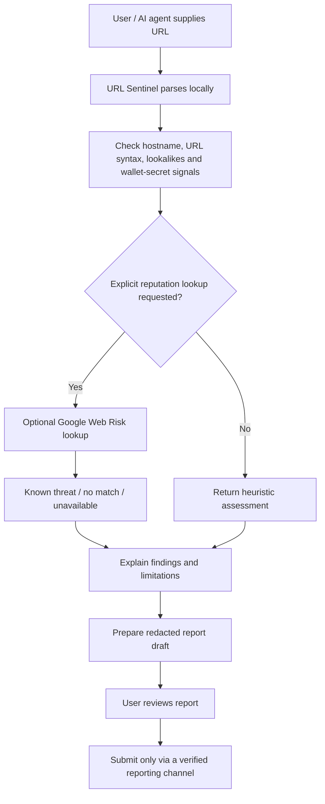

# PayGuard

**A policy-based x402 payment-intent security checker with an optional pre-payload client guard for AI agents.**

PayGuard evaluates an x402-style payment request against a separate, explicit policy describing what the user intended to pay for. It returns **PASS**, **REVIEW**, or **BLOCK** with check-by-check explanations.

## Security boundary

PayGuard does not sign, authorize, or execute payments, and it does not independently enforce a block. A `PASS` means only that the supplied request fields match the supplied policy. It does **not** authenticate the merchant, prove request origin, inspect chain state or token contract safety, or guarantee a payment is safe.

Never put private keys, seed phrases, API tokens, or user credentials into this repository.

## MVP checks

- HTTPS resource URL matches the user's expected resource.
- Payment scheme, network, asset identifier, recipient, atomic-unit amount, and validity timeout match explicit policy.
- Conflicting current and legacy amount fields fail closed.
- Mixed acceptable and unacceptable payment alternatives do not receive an overall `PASS`.
- Incomplete policy returns `REVIEW`.

## Local development

Requires Node.js 20+.

```bash
npm test
npm run build
```

## Example

See the tests for complete request and policy examples. Amounts are integer strings in the asset's smallest units; do not use floating-point values for payment amounts.

## Flow



URL Sentinel does not open or fetch the submitted URL, read the user's computer, request wallet secrets, or automatically notify PayBox. Reputation lookup is opt-in and sends the normalized origin/path without query parameters to Google Web Risk. The URL path may still contain identifiers, so only enable reputation lookup when it is appropriate to share that URL with the provider.

## URL Sentinel

PayGuard includes a URL Sentinel tool for checking a user-supplied URL for common phishing and impersonation indicators. It parses the supplied address but never opens the submitted URL. Checks include embedded credentials, non-HTTPS URLs, IP-literal hosts, punycode/IDN labels, URL shorteners, likely lookalikes compared with a separately supplied trusted domain, suspicious PayBox-branded hostnames, wallet-recovery terminology, and a resource/expected-domain mismatch.

Verdicts are evidence-oriented:
- `KNOWN_MALICIOUS`: an enabled Google Web Risk lookup returned a threat match.
- `SUSPICIOUS` / `CAUTION`: heuristic signals need independent verification.
- `EXPECTED_DOMAIN_MATCH`: a hostname matches a user-supplied trusted domain; this does not guarantee the page is safe.
- `NO_KNOWN_THREAT`: the configured reputation lookup found no match; absence of a match is not proof of legitimacy.
- `UNVERIFIED`: the available information is insufficient to call the website legitimate.

### Optional Google Web Risk lookup

Set `GOOGLE_WEB_RISK_API_KEY` in the **server-side environment only**. The tool performs a lookup only when `checkReputation: true` is explicitly supplied. To reduce accidental disclosure, the reputation query removes all URL query parameters, credentials and fragments; this may miss threat records scoped to those parts of a URL. The API key is sent in the request header and is never expected as tool input.

Google lists the Web Risk Lookup API's first 100,000 calls per month as free at the time of writing; confirm current pricing and terms before deployment: https://cloud.google.com/web-risk/pricing

## Threat reports

`payguard_prepare_threat_report` creates a redacted JSON draft. It does not submit the report or notify PayBox because no verified official reporting endpoint is configured in this project. Review and submit it only through a route confirmed by PayBox. Reports are allegations for investigation, not proof of malicious intent. The draft does not include free-form user notes because automated secret redaction cannot reliably identify every seed phrase or credential format.

## Local API, k6 and Grafana testing

This repository includes a read-only HTTP wrapper for local testing, k6 scenarios, Prometheus metrics, and a provisioned Grafana dashboard. These are development tools; they do not execute payments or prove transaction blocking.

### Requirements

- Node.js 20+ for the API and automated tests.
- Docker Desktop with Docker Compose v2 for Grafana, Prometheus, and k6 containers.

### Run automated tests

```bash
npm test
npm run build
node --check server.mjs
node --check dist/plugin.mjs
```

### Start the API directly

```bash
npm start
```

The local API defaults to `http://127.0.0.1:8080` and provides `GET /health`, `GET /metrics`, and these JSON POST endpoints:

- `/api/analyze-url`
- `/api/check-payment`
- `/api/threat-report`

The supplied URL is parsed but never visited. Reputation lookup is disabled unless a request explicitly sets `checkReputation: true` and the server-side `GOOGLE_WEB_RISK_API_KEY` is configured.

### Interactive Web Dashboard

Open `http://127.0.0.1:8080/dashboard` (or simply visit the root URL `http://127.0.0.1:8080` in any web browser) to access the interactive PayGuard UI:
- **Telemetry & Service Health**: Real-time health check, uptime, total request counter, and in-flight request status.
- **URL Sentinel Scanner**: Interactive sandbox with preset attack simulations (Unicode homoglyphs, brand spoofing, subdomain/suffix bypasses, credential leak detection) and instant verdict rationale.
- **Payment Guard Policy Studio**: Test autonomous agent payment criteria against custom policies (`PASS`, `REVIEW`, `BLOCK`).
- **Threat Report Studio**: Produce sanitized incident report drafts with client-side credential redaction and JSON export.
- **x402 Bazaar Discovery & Simulator**: View registered payment-gated capabilities and inspect simulated HTTP 402 challenge payloads.

### Start Grafana and Prometheus

Copy `.env.example` to `.env`, then set a long, unique value for `GRAFANA_ADMIN_PASSWORD`. Keep `.env` private.

```bash
docker compose up --build -d payguard-api prometheus grafana
docker compose ps
```

Open Grafana at http://127.0.0.1:3000 (username `admin`, password from `.env`). Prometheus is at http://127.0.0.1:9090. Ports bind to loopback only.

### Run k6

With the services above running, execute:

```bash
docker compose --profile loadtest run --rm k6 run -o experimental-prometheus-rw /scripts/smoke.js
docker compose --profile loadtest run --rm k6 run -o experimental-prometheus-rw /scripts/load.js
```

The load scenario ramps up to 25 virtual users for about 90 seconds. Initial thresholds are development targets (less than 1% failed requests, p95 below 500 ms, p99 below 1 second), not production capacity guarantees. k6 sends metrics to the enabled Prometheus remote-write receiver; Grafana's `PayGuard API & k6 Load Test` dashboard displays request rate, latency, HTTP errors, verdicts, and in-flight API requests.

Stop the stack with `docker compose down`. Use `docker compose down -v` only if you intend to delete persisted metrics and Grafana data.

Metrics use low-cardinality route/status/verdict labels and deliberately omit the submitted URL and domain. Concurrency limits and sliding window rate limits are implemented in `server.mjs`.

## x402 Protocol & Bazaar Discovery

PayGuard implements the x402 HTTP 402 Payment Required flow and provides standard Bazaar discovery metadata for autonomous AI agents in `paybox.mjs`:
- Unpaid requests can receive an HTTP 402 challenge with payment requirement fields and Bazaar discovery catalog information.
- Supports Base Sepolia testnet (`eip155:84532`) and test USDC asset configuration.
- Verifies payment proofs (`Payment-Signature` / CDP transaction proof) to settle security report requests.

## x402 client pre-signing protection

PayGuard can be attached to the x402 TypeScript client before payment payload creation. The adapter evaluates the **selected** requirement together with the challenge resource URL and returns the SDK's abort result for both `BLOCK` and `REVIEW`. Only a complete `PASS` allows the SDK to continue to its scheme-specific payment-payload creation step.

The adapter has no runtime dependency on x402. It uses the public `onBeforePaymentCreation` hook shape verified against `@x402/core` 2.29.0; keep the SDK version pinned and re-check this contract when upgrading.

```js
import { x402Client } from "@x402/core";
import { registerPayGuardX402 } from "payguard-paybox-plugin";

const client = new x402Client();

registerPayGuardX402(client, {
  intent: {
    expectedResourceUrl: "https://api.example.com/report",
    maxAmountAtomic: "2000",
    allowedNetworks: ["eip155:8453"],
    allowedAssets: ["0xaaaaaaaaaaaaaaaaaaaaaaaaaaaaaaaaaaaaaaaa"],
    allowedPayTo: ["0xbbbbbbbbbbbbbbbbbbbbbbbbbbbbbbbbbbbbbbbb"],
    allowedSchemes: ["exact"],
    maxTimeoutSeconds: 300
  }
});
```

This is a client-side pre-payload guard, not a global wallet restriction. It protects only payment creation performed through the x402 client instance where the hook is registered. It does not control other wallets, other clients, direct signing calls, or unrelated payment paths. A `PASS` is a policy match, not proof that the merchant or token is legitimate. Supply policy values from a trusted user/configuration source, never from the 402 response itself.

## PayBox Marketplace Integration

PayGuard exports an MCP/x402 compliant plugin manifest in `paybox.mjs` exposing:
- `payguard_analyze_url`: URL phishing and impersonation sentinel
- `payguard_check_payment_intent`: x402 payment requirements policy verifier
- `payguard_prepare_threat_report`: privacy-redacted threat report generator

Integration verification status: Local unit and end-to-end simulated flows verified; distribution artifacts are bundled into standalone ESM and CommonJS modules (`dist/index.js`, `dist/index.mjs`, `dist/index.cjs`, `dist/plugin.mjs`) with zero external runtime dependencies and integrated Model Context Protocol (MCP) stdio discovery (`initialize`, `tools/list`, and `tools/call`) so marketplace checkers can discover tools without executing them. See [PAYBOX_SUBMISSION.md](file:///e:/PayGuard.-main/PAYBOX_SUBMISSION.md) for complete checklist.

## License

MIT
