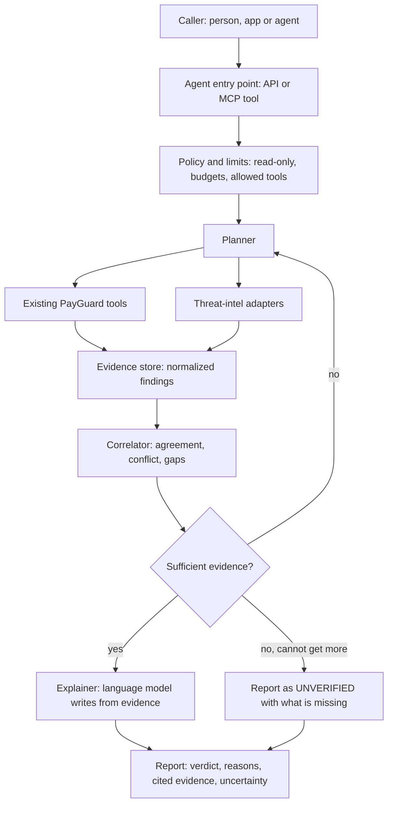

# AI Security Agent: Proposed Architecture

> [!WARNING]
> **Status: Planned. Not implemented.** This page is a design proposal for PayGuard's next development phase. No agent, planner or language-model integration exists in the repository today. Nothing here should be described as a current feature.

Related: [Whitepaper, Section 10](whitepaper.md), [Architecture](architecture.md), [MCP Tools](mcp-tools.md), [Security Model](security-model.md).

---

## 1. Purpose

PayGuard's seven tools each answer one narrow question. A person or an outer agent must decide which tool to call, in what order, and how to combine the answers. The AI Security Agent would take that job: given a question such as "is this link, token or payment safe to interact with?", it would plan checks, run the existing tools, correlate the evidence and explain the result.

The agent coordinates and explains. It does not replace the deterministic tools and does not decide verdicts by itself.

---

## 2. What exists and what is proposed

| Component | Status | Notes |
| :--- | :--- | :--- |
| Seven security tools (URL, payment policy, calldata, token, address, wallet scan, threat report) | Implemented | Callable via MCP, REST and as a library |
| MCP stdio server | Implemented | Lets an external agent call the tools |
| x402 client hook | Implemented | Policy gate before payment creation |
| Investigation planner | Planned | Chooses which tools to run |
| Evidence store and correlation | Planned | Normalizes results from tools and providers |
| Threat-intelligence adapters (feeds, additional providers) | Planned | A feed-refresh design exists on an unmerged branch |
| Explanation layer (language model) | Planned | Writes the report from evidence |
| Evaluation suite | Planned | Required before any release |
| Agent API and MCP tool (`payguard_investigate`, name provisional) | Planned | |

---

## 3. Proposed architecture



### 3.1 Components

**Policy and limits.** Defines the tools the agent may call (read-only tools only), a maximum number of tool calls per investigation, timeouts and a cap on outbound requests.

**Planner.** Maps an input type to a sequence of checks. For example, a URL leads to URL Sentinel, then address checks for any contract it references. The first version should be a fixed, rule-based plan, so behavior is testable. A model-assisted planner is a later step and only inside the same limits.

**Evidence store.** Every tool result is stored as a normalized finding: source, check id, status, detail, timestamp and whether it came from a provider. Findings are never edited by the model.

**Correlator.** Looks for agreement (two sources flag the same address), conflict (one source clean, one flagged) and gaps (a source was unavailable). Conflict and gaps reduce confidence and are reported.

**Explainer.** A language model receives the evidence set and writes the explanation. It may not add facts that are absent from the evidence and may not change a tool verdict. The output cites finding ids.

---

## 4. Output contract

The report would reuse PayGuard's existing conventions so downstream consumers need no new concepts.

```json
{
  "subject": { "type": "url", "value": "https://example.test/claim" },
  "verdict": "REVIEW",
  "confidence": "LOW",
  "findings": [
    { "id": "f1", "source": "url-sentinel", "check": "possible_lookalike_domain", "status": "warning" },
    { "id": "f2", "source": "goplus", "check": "address_reputation", "status": "unavailable" }
  ],
  "uncertainty": ["Address reputation provider did not respond", "Site content was not inspected"],
  "recommendation": "Do not connect a wallet until the domain is verified through an independent source.",
  "explanation": "Plain-language summary that cites f1 and f2.",
  "limitations": ["Advisory only", "Base Mainnet (8453) coverage"]
}
```

This is an illustrative shape for a design discussion. Field names are provisional and no endpoint returns it today.

---

## 5. Safety requirements

| Requirement | Reason |
| :--- | :--- |
| No signing, keys, wallet access or payment capability | Preserves the non-custodial design |
| Read-only tools only | A planning error cannot move value |
| Treat tool output and fetched content as data, never as instructions | Prevents prompt injection from a hostile page, token name or payment request |
| Model cannot override or soften a tool verdict | Keeps deterministic checks authoritative |
| Every claim in the explanation links to a finding | Makes hallucinations detectable |
| Hard budgets on calls, time and outbound requests | Limits cost and abuse |
| Outbound fetches only through an SSRF-restricted collector | Required before any live website inspection |
| Fail closed to UNVERIFIED | Missing evidence is never a pass |

---

## 6. Dependencies on other roadmap work

| Dependency | Why the agent needs it | Status |
| :--- | :--- | :--- |
| Authentication and quotas | An agent endpoint is more expensive to run than a single check | Planned |
| Passive website collector with SSRF and egress controls | Needed to inspect a live site safely | Exists on unmerged branch; not production-verified |
| Threat-intelligence feed refresh and storage | Gives the correlator a second evidence source | Exists on unmerged branch; not verified live |
| Permit, EIP-712, EIP-7702 and multicall inspection | Without these the agent cannot judge many signing requests | Planned |

---

## 7. Evaluation plan

The agent should not ship without published evaluation results, including method and failures.

1. **Verdict fidelity.** The report verdict must equal the underlying tool verdict in every test case.
2. **Grounding.** Every factual statement in an explanation must map to a finding. Measure the share that do not.
3. **Uncertainty handling.** With a provider disabled, the agent must return UNVERIFIED or lowered confidence rather than a clean result.
4. **Prompt-injection tests.** Pages, token names and payment fields that contain instructions must not change the plan or the verdict.
5. **Budget tests.** The agent must stop at its call and time limits.
6. **Regression set.** A fixed list of known look-alike domains, known honeypot tokens and benign controls, with expected outcomes recorded.

---

## 8. Incremental delivery

| Step | Scope | Exit criterion |
| :--- | :--- | :--- |
| A | Fixed-plan orchestrator over existing tools, no language model, structured report only | Tests pass; report verdict equals tool verdict |
| B | Evidence store and correlator, with a second threat-intel source | Conflict and gap cases covered by tests |
| C | Explanation layer with grounding checks | Grounding and injection tests pass |
| D | MCP tool and API endpoint with authentication and quotas | Documented limits; load test recorded |
| E | Independent review | Review findings addressed |

---

## 9. Open questions

- Which language model and hosting arrangement, and who bears the inference cost.
- Whether explanations should be generated server-side or by the caller's own model from the returned evidence. Returning evidence only is simpler and safer for a first release.
- Which additional threat-intelligence sources have licenses that permit this use.
- How to present confidence without implying a probability that the evidence does not support.
