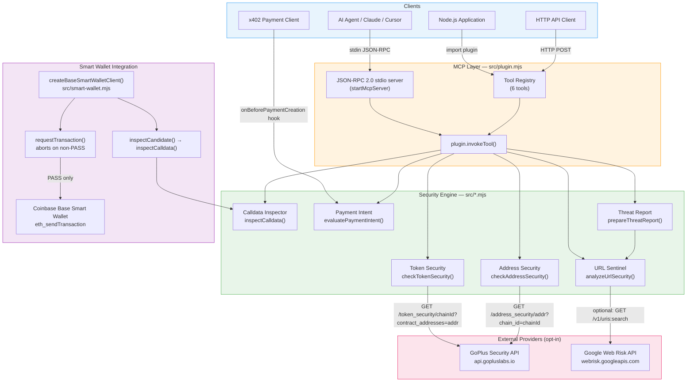
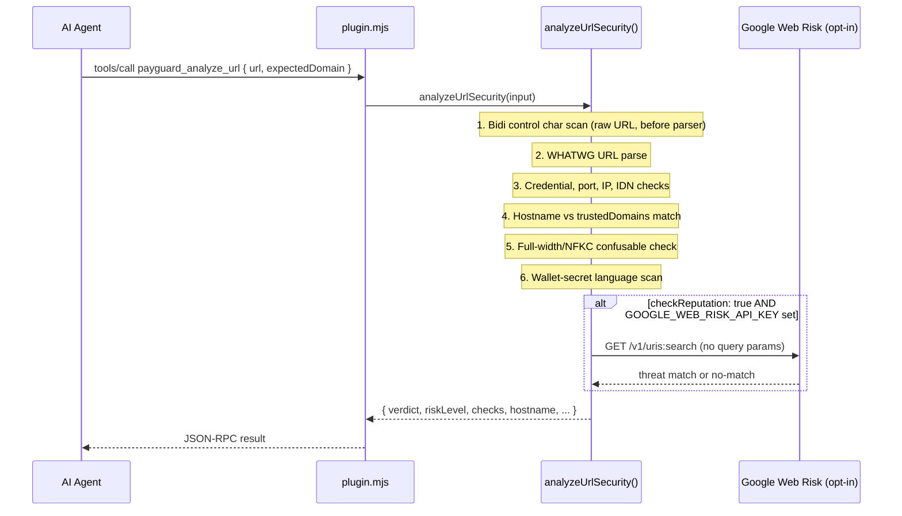
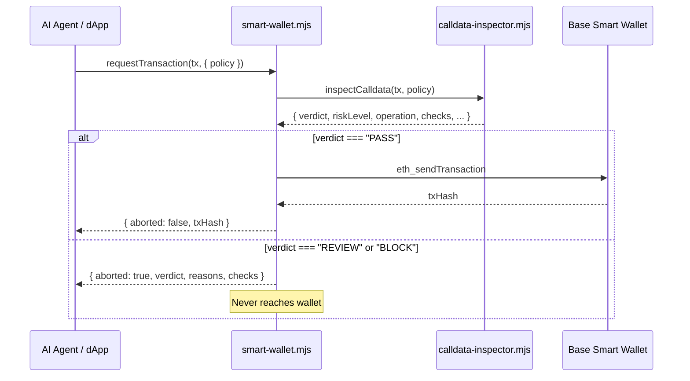
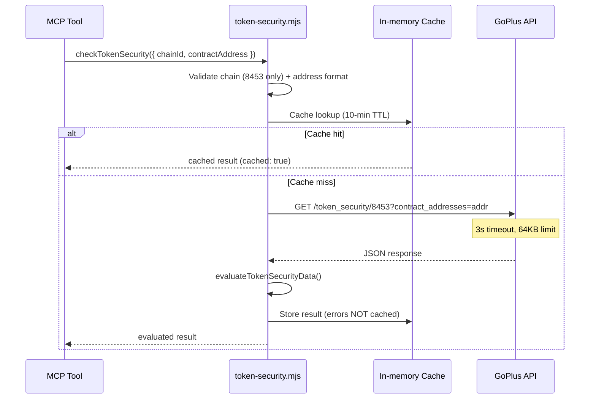
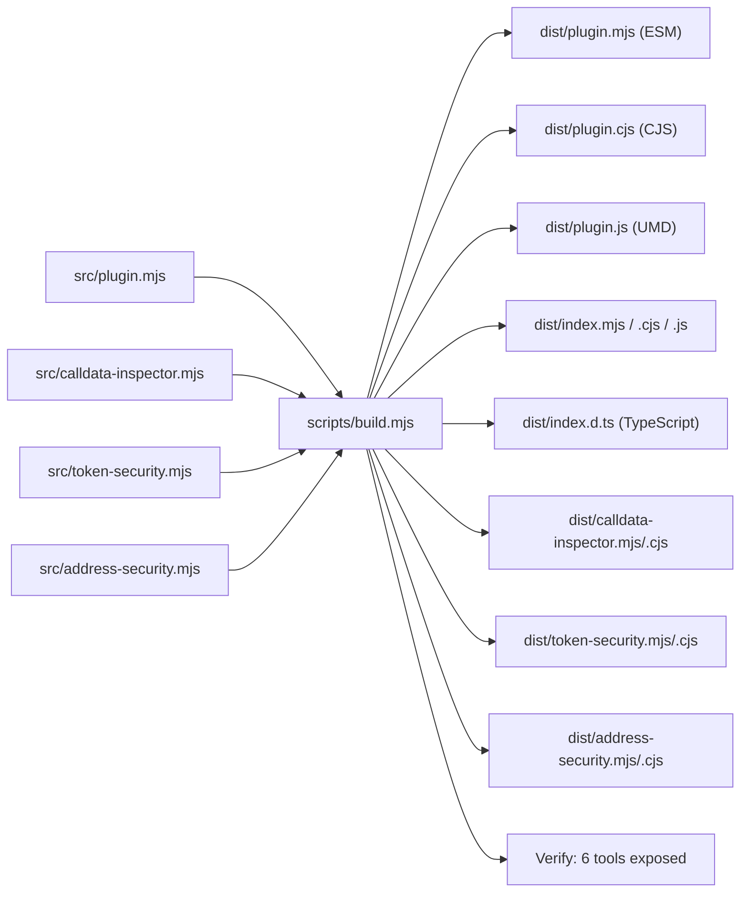

# PayGuard Architecture

## Overview

PayGuard is a read-only, advisory Web3 security platform built with native Node.js ESM. It provides six MCP tools for AI agents and developers to inspect transactions, URLs, and token/address reputation before any signing action occurs.

The architecture follows a strict layering principle: **inspect first, never act**. No module contacts a blockchain, signs data, or broadcasts transactions.

---

## High-Level System Diagram

---

## Module Descriptions

### `src/plugin.mjs` — MCP Plugin and Tool Registry

The central orchestrator. Exports:
- `plugin` — the MCP plugin manifest (id, name, version, tools array)
- `tools` — frozen array of 6 tool descriptors with JSON Schema input schemas
- `startMcpServer()` — JSON-RPC 2.0 stdio server handling `initialize`, `tools/list`, `tools/call`, and `ping`
- Individual tool handlers: `evaluatePaymentIntent`, `analyzeUrlSecurity`, `prepareThreatReport`, `payGuardInspectCalldata`, `payGuardCheckTokenSecurity`, `payGuardCheckAddressSecurity`

The stdio server is auto-started when the file is executed directly or when `MCP_STDIO=1` is set.

### `src/calldata-inspector.mjs` — EVM Calldata Inspector

Pure, deterministic, synchronous analysis. No network calls. Exports:
- `inspectCalldata(tx, policy)` — decodes EVM transaction calldata and evaluates it
- `SELECTORS` — ERC-20 selector constants (`approve`, `transfer`, `transferFrom`)
- `UINT256_MAX` — bigint constant for unlimited allowance detection

Supported operations: `ERC20_APPROVE`, `ERC20_TRANSFER`, `ERC20_TRANSFER_FROM`, `NATIVE_TRANSFER`, `UNKNOWN_OPERATION`.

### `src/token-security.mjs` — GoPlus Token Security

Async, network-touching. Base Mainnet (8453) only. Exports:
- `checkTokenSecurity({ chainId, contractAddress, fetchImpl, timeoutMs, apiKey })`
- `evaluateTokenSecurityData(rawToken, chainId, contractAddress)` — pure evaluation function
- Cache helpers: `clearTokenCache()`, `getTokenCacheSize()`

**Endpoint:** `GET https://api.gopluslabs.io/api/v1/token_security/{chainId}?contract_addresses={address}`

### `src/address-security.mjs` — GoPlus Address Security

Async, network-touching. Base Mainnet (8453) only. Exports:
- `checkAddressSecurity({ chainId, address, fetchImpl, timeoutMs, apiKey })`
- `evaluateAddressSecurityData(rawResult, chainId, address)` — pure evaluation function
- Cache helpers: `clearAddressCache()`, `getAddressCacheSize()`

**Endpoint:** `GET https://api.gopluslabs.io/api/v1/address_security/{address}?chain_id={chainId}`

> [!NOTE]
> The URL structure differs from Token Security: the **address is a path segment** in Address Security, while **chainId is a path segment** in Token Security.

### `src/smart-wallet.mjs` — Base Smart Wallet Integration

Exports `createBaseSmartWalletClient(options)` which returns a client object with:
- `connect(provider)` — EIP-1193 `eth_requestAccounts` (no keys)
- `switchChain(chainId, provider)` — `wallet_switchEthereumChain`
- `inspectCandidate(tx, policy)` — delegates to `inspectCalldata()`
- `requestTransaction(tx, options)` — inspects, aborts on non-PASS, then calls `eth_sendTransaction`
- `disconnect(provider)` — best-effort cleanup

### `server.mjs` — Local HTTP API Server

An HTTP wrapper for local development. Implements:
- Request concurrency limits
- Sliding-window rate limiting
- Prometheus metrics (`/metrics`)
- Routes for each security tool

Does not execute payments or contact blockchains.

---

## Data Flow: URL Sentinel

---

## Data Flow: Pre-Signing Transaction Inspection

---

## Data Flow: GoPlus Token/Address Security

---

## Build Pipeline

---

## Technology Stack

| Layer | Technology |
|-------|-----------|
| Runtime | Node.js 20+ (native ESM) |
| Test runner | `node --test` (built-in) |
| Network | Native `fetch` + `AbortController` |
| EVM address handling | Native JavaScript BigInt + regex |
| Smart Wallet SDK | `@coinbase/wallet-sdk` 4.4.0 |
| x402 hook | `@x402/core` 2.29.0 (devDependency) |
| Containerization | Docker + docker-compose |
| Observability | Prometheus + Grafana + k6 |
| CI | GitHub Actions |

**Zero external runtime dependencies** in the core security analysis modules (calldata inspector, URL sentinel, payment intent, threat report).

---

## Security Architecture Properties

1. **Fail-closed**: GoPlus errors → `UNVERIFIED`, never `PASS`
2. **No outbound requests in core**: URL Sentinel, calldata inspector, and payment intent guard make no network calls
3. **Injectable fetch**: `fetchImpl` parameter allows deterministic offline testing without mocking globals
4. **Fixed endpoints**: GoPlus and Web Risk URLs are hardcoded constants — never user-controlled
5. **Input size limits**: 64,000 chars max for URL input; 64 KB max for GoPlus API response bodies
6. **Cache isolation**: Successful GoPlus results cached 10 min; errors never cached (avoids stale false PASSes)
7. **API keys**: Server-side env vars only; never in tool output, logs, or client bundles
8. **Pre-signing abort**: `requestTransaction()` aborts before `eth_sendTransaction` for any non-PASS verdict
