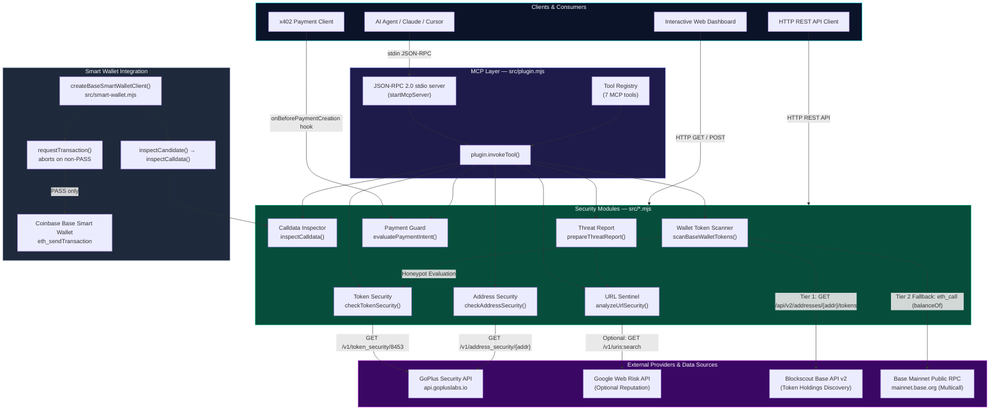

# PayGuard Architecture

## Overview

PayGuard is a free, Base-first ecosystem security platform and advisory sentinel built with native Node.js ESM. It provides seven Model Context Protocol (MCP) tools for AI agents, developers, and human Web3 users to inspect transactions, URLs, token honeypots, address reputation, and wallet assets before any signing or transfer action occurs.

The architecture follows a strict layering principle: **inspect first, never act**. No module possesses private keys, executes payments, or signs transactions outside explicit user-authorized client instances.

---

## High-Level System Diagram

---

## Module Descriptions

### `src/plugin.mjs` — MCP Plugin and Tool Registry

The central orchestrator and MCP server. Exports:
- `plugin` — the MCP plugin manifest (`id: "payguard-paybox-plugin"`, version, tools array).
- `tools` — frozen array of 7 tool descriptors with JSON Schema input schemas:
  1. `payguard_check_payment_intent`
  2. `payguard_analyze_url`
  3. `payguard_prepare_threat_report`
  4. `payguard_inspect_calldata`
  5. `payguard_check_token_security`
  6. `payguard_check_address_security`
  7. `payguard_scan_wallet_tokens`
- `startMcpServer()` — JSON-RPC 2.0 stdio server handling `initialize`, `tools/list`, `tools/call`, and `ping`.
- Individual tool dispatchers routing parameters to domain-specific modules.

The stdio server auto-starts when `src/plugin.mjs` is executed directly or when `MCP_STDIO=1` is set in the environment.

---

### `src/wallet-token-scanner.mjs` — Base Wallet Token Scanner

Discovers and screens ERC-20 token holdings in any Base Mainnet (Chain ID 8453) wallet.

**Key Architecture Components:**
1. **Two-Tier Discovery:**
   - **Tier 1 (Blockscout API v2):** Attempts to fetch token holdings from `https://base.blockscout.com/api/v2/addresses/{address}/tokens?type=ERC-20`. When accessible, returns all arbitrary tokens.
   - **Tier 2 (RPC Multicall Fallback):** When indexers encounter rate limits or Cloudflare bot challenges, falls back to direct on-chain `eth_call` queries (`balanceOf(address)`) on `https://mainnet.base.org`. This fallback evaluates the 7 curated Base canonical tokens plus any caller-specified `customTokenAddresses`.
2. **Canonical Token Registry:** Authoritative mapping of official Base assets (WETH, USDC, cbETH, VIRTUAL, DAI, USDbC, AERO) with known contract addresses.
3. **Impersonation Detector (`checkTokenImpersonation`):** Identifies lookalike tokens that reuse well-known symbols while pointing to unauthorized contract addresses.
4. **GoPlus Security Bridge:** Evaluates honeypot flags, buy/sell taxes, and owner balance alteration privileges for every holding with non-zero balance.

---

### `src/calldata-inspector.mjs` — EVM Calldata Inspector

Pure, deterministic, synchronous EVM calldata analyzer with zero network dependencies.
- **Decodes Selectors:** `approve(address,uint256)`, `transfer(address,uint256)`, `transferFrom(address,address,uint256)`.
- **Unlimited Allowance Trap:** Flags `approve()` calls where amount equals `2^256 - 1` (`0xffffffffffffffffffffffffffffffffffffffffffffffffffffffffffffffff`).
- **Policy Enforcement:** Compares target spenders and recipients against caller-specified allowlists.
- **Fail-Closed:** Truncated calldata, invalid hex, or unknown selectors return structured `BLOCK` or `REVIEW` verdicts.

---

### `src/token-security.mjs` — GoPlus Token Security Integration

Interrogates the GoPlus Token Security API for Base Mainnet (Chain ID 8453):
- **Contract Risk Analysis:** Evaluates honeypots (`is_honeypot`), balance alteration (`owner_change_balance`), buy/sell taxes, pausable transfers, and unverified source code.
- **In-Memory Cache:** Caches successful responses for 10 minutes to protect upstream rate limits.
- **Fail-Closed Error Handling:** Network timeouts (3000ms), 429 rate limits, or malformed JSON return `UNVERIFIED` — never defaulting to `PASS`.

---

### `src/address-security.mjs` — GoPlus Address Security Integration

Interrogates the GoPlus Address Security API for Base Mainnet (Chain ID 8453):
- **Entity Screening:** Flags sanctioned addresses, phishing records, cybercrime involvement, mixer usage, and malicious contract creators.
- **Cache & Resilience:** In-memory caching and strict response payload size ceiling (64 KB).

---

### `src/smart-wallet.mjs` — Base Smart Wallet Pre-Signing Client

Wraps `@coinbase/wallet-sdk@4.4.0` with PayGuard's pre-signing security perimeter:
- Intercepts proposed transactions before `eth_sendTransaction` is called.
- Decodes candidate calldata using `inspectCalldata()`.
- Aborts automatically with `TransactionBlockedError` if the verdict is `BLOCK` or `REVIEW`.

---

### `server.mjs` — Operator Dashboard & HTTP REST Gateway

HTTP/1.1 microservice running with native Node.js ESM and zero external HTTP frameworks:
- **Routes Exposed:**
  - `GET /` — Service JSON manifest and endpoint directory (or interactive landing page for browser requests).
  - `GET /dashboard` — Interactive dark-theme operator security console (`public/index.html`).
  - `GET /docs` & `GET /whitepaper` & `GET /faq` — Lightweight documentation view.
  - `POST /api/analyze-url` — URL Sentinel scanner.
  - `POST /api/check-payment` — x402 payment intent policy evaluator.
  - `POST /api/threat-report` — Privacy-conscious threat report generator.
  - `POST /api/inspect-calldata` — Pre-signing calldata inspector.
  - `POST /api/token-security` — GoPlus Base token security auditor.
  - `POST /api/address-security` — GoPlus Base address security auditor.
  - `POST /api/scan-wallet-tokens` — Base wallet token scanner.
  - `GET /api/capabilities` — Service feature & provider status manifest.
  - `GET /health` — Read-only health probe.
  - `GET /metrics` — Prometheus metrics export.
  - `GET /.well-known/x402-bazaar.json` — PayBox Bazaar discovery metadata.
- **Security Protections:** In-memory sliding-window rate limiting (120 req/min/IP), 64 KB maximum request body ceiling, strict CORS headers, and anti-SSRF protections.
