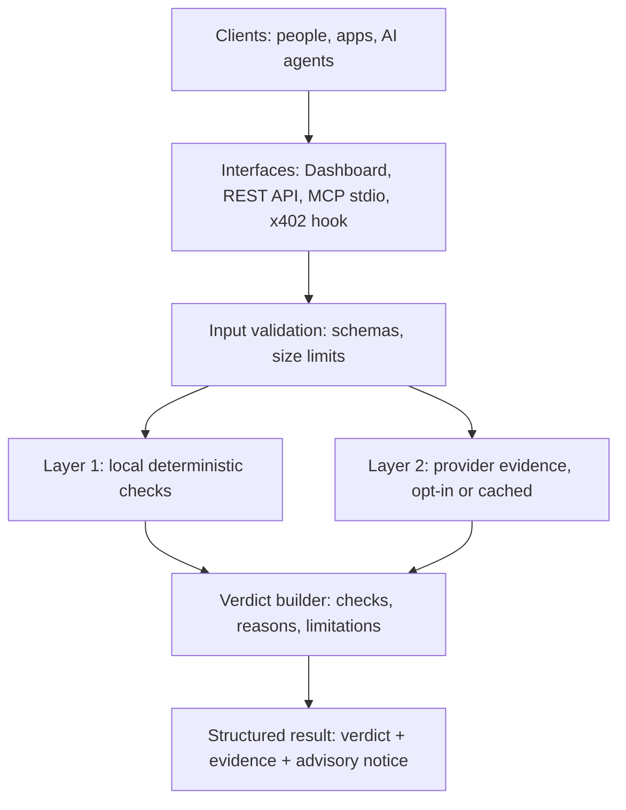
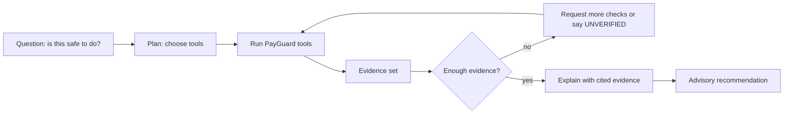

# PayGuard Technical Whitepaper

**A Base-first pre-interaction security layer for people, developers and AI agents**

**Version 1.2.0 | November 2026**

Mission: Verify Before You Trust

Repository: [github.com/technea/PayGuard](https://github.com/technea/PayGuard) (branch: main)

> [!IMPORTANT]
> This paper separates what exists from what is proposed. Every capability carries one of three labels: **Implemented**, **Partially Supported** or **Planned**. The AI Security Agent described in Section 10 is a **Planned** development objective. It is not a current product feature. PayGuard has not received a grant, funding or measured ecosystem adoption, and nothing here should be read that way.

Companion documents: [Architecture](architecture.md), [Security Model](security-model.md), [API Reference](api-reference.md), [MCP Tools](mcp-tools.md), [AI Security Agent design](ai-security-agent.md), [Limitations and Roadmap](limitations-roadmap.md).

---

## Contents

1. Executive Summary
2. The Problem: Web3 Security and Trust Challenges
3. Why Existing Security Approaches Are Not Enough
4. Mission and Vision
5. Product Overview
6. Core Security Capabilities
7. System Architecture and Security Intelligence Layers
8. Evidence-Based Risk Assessment
9. Base Ecosystem Integration
10. AI Agent Security: Vision and Future Architecture
11. MCP Integration and Agent Interoperability
12. Security, Privacy and Non-Custodial Design
13. Current Implementation and Technical Limitations
14. Development Roadmap
15. Ecosystem Impact and Potential Adoption
16. Open-Source Approach and Sustainability
17. Conclusion

---

## 1. Executive Summary

Transactions on Base are final once confirmed. Most losses in Web3 do not come from broken cryptography. They come from a person, or increasingly a software agent, trusting the wrong thing: a look-alike domain, a counterfeit token, an unlimited approval, or a payment request that asks for more than intended.

PayGuard is a free, open-source, advisory security layer for the Base ecosystem. Before a user or agent acts, PayGuard inspects the evidence it can verify and returns a structured verdict with the reasons behind it. It covers five areas:

- URL and domain analysis (look-alike hostnames, Unicode tricks, Base impersonation).
- Token and contract risk (honeypot, tax and owner-privilege flags from a threat-intelligence provider).
- Wallet and address screening (holdings scan and counterparty reputation).
- Transaction calldata inspection (ERC-20 `approve`, `transfer`, `transferFrom`).
- x402 payment-policy verification (compare a payment request against a policy the user wrote in advance).

The checks are exposed three ways: a REST API, a dashboard, and seven Model Context Protocol (MCP) tools that AI agents can call directly.

PayGuard follows four rules. It is **non-custodial** (no keys, no signing for users, no custody). It **fails closed** (missing evidence returns `UNVERIFIED`, never a silent pass). It is **advisory** (a verdict informs a decision and is not a guarantee). It is **honest about scope** (Base Mainnet, chain ID 8453, is the supported network).

The next development phase is an **AI Security Agent** that would coordinate these tools, correlate evidence and explain findings. That agent is a proposal, described in Section 10 and in the [design document](ai-security-agent.md).

---

## 2. The Problem: Web3 Security and Trust Challenges

### 2.1 Finality shifts risk to the moment before signing

There is no chargeback on Base. The only reliable control point is before a wallet signs or an agent pays. At that moment the person or agent must decide using limited information, often under time pressure.

### 2.2 Common attack patterns

| Pattern | How it works | Typical consequence |
| :--- | :--- | :--- |
| Domain impersonation | Hostnames such as `bases.org`, or a Cyrillic letter in place of a Latin one | Wallet connected to a drainer site |
| Token impersonation | Contract reuses a well-known ticker such as `USDC` at a different address | Victim holds a worthless token |
| Honeypot contracts | Buying works, selling reverts or is taxed heavily | Capital cannot be withdrawn |
| Owner privilege abuse | Owner can change balances, pause transfers or mint | Holders diluted or frozen |
| Unlimited approvals | `approve(spender, 2^256 - 1)` | Spender can drain the token later |
| Malicious payment requests | Altered recipient, inflated amount, unexpected asset or network | Agent pays the wrong party or too much |
| Risky counterparties | Address linked to phishing, sanctions or mixers | Loss, or compliance exposure |

### 2.3 Why autonomous agents raise the stakes

AI agents that pay for APIs and services over HTTP (the x402 pattern) act without a person reading each request. An agent cannot see a browser address bar, tends to read URLs as plain text, and may select a token by symbol. A single malicious payment requirement or link can therefore turn into a transaction at machine speed.

### 2.4 Three misconceptions PayGuard is built around

1. **HTTPS does not prove legitimacy.** TLS encrypts the connection. Certificates for any domain can be issued automatically in seconds, so phishing sites routinely present a padlock.
2. **Verified contract source does not prove a token is safe or official.** A verification badge shows that source code compiles to the deployed bytecode. Deployers of malicious contracts can and do verify them.
3. **A token name or symbol does not establish identity.** `name()` and `symbol()` are free-form strings. The contract address is the only authoritative identifier.

---

## 3. Why Existing Security Approaches Are Not Enough

The following are general categories, not assessments of specific products. Each is useful. None covers the whole pre-interaction window on its own.

| Approach | What it does well | Gap PayGuard targets |
| :--- | :--- | :--- |
| Wallet and browser warnings | Warn at the moment of connecting or signing | Not available to headless agents; limited explanation of why |
| Domain blocklists | Catch known bad sites | Miss new domains; say nothing about unlisted look-alikes |
| Explorer badges | Show that source matches bytecode | Do not indicate intent or safety |
| Smart-contract audits | Deep review of one codebase | Slow, costly, and unavailable for most tokens a user meets |
| Reputation APIs | Fast flags on known-bad contracts and addresses | Return raw flags; need interpretation and fail-closed handling |
| Wallet spend limits | Cap what an agent can spend | Do not judge whether the payee or request is the intended one |

PayGuard's contribution is to combine local deterministic checks with provider evidence, explain each result, and expose the same logic to humans (dashboard), developers (API) and agents (MCP) without taking custody of anything.

---

## 4. Mission and Vision

**Mission: Verify Before You Trust.** Give people and software an inspectable check that runs before value moves, and show the evidence behind each answer.

**Vision.** An ecosystem where links, tokens, approvals and payment requests are checked against explicit, independent evidence before action, and where an agent can ask "is this safe to do?" and receive an answer that states its own uncertainty. The vision is incremental. Today the checks listed in Section 6 exist. The investigation and correlation layer in Section 10 is what comes next.

---

## 5. Product Overview

PayGuard is a Node.js (native ES modules) service and library with no web framework. It is delivered as:

| Surface | Description | Status |
| :--- | :--- | :--- |
| Security modules | Pure functions in `src/` for each check | Implemented |
| MCP server | Seven tools over JSON-RPC 2.0 stdio | Implemented |
| REST API | `POST /api/*` endpoints plus health, capabilities and metrics | Implemented |
| Dashboard and docs | Browser console, landing page, documentation viewer | Implemented |
| x402 client hook | `createPayGuardX402Hook`, `registerPayGuardX402` | Implemented |
| Smart-wallet wrapper | Opt-in client that aborts on non-`PASS` calldata verdicts | Implemented (opt-in) |
| Paid-endpoint mode | Optional x402 payment gate on the API | Partially Supported (see 13) |

### Verdicts

Verdict vocabularies differ slightly by tool because the evidence differs. See the [API Reference](api-reference.md) for exact fields.

| Tool family | Verdict field and values |
| :--- | :--- |
| x402 payment policy | `status`: PASS, REVIEW, BLOCK |
| Calldata, token, address, wallet | `verdict`: PASS, REVIEW, BLOCK, UNVERIFIED |
| URL Sentinel | `verdict`: KNOWN_MALICIOUS, SUSPICIOUS, CAUTION, NO_KNOWN_THREAT, EXPECTED_DOMAIN_MATCH, UNVERIFIED |

---

## 6. Core Security Capabilities

### 6.1 URL and domain security — Implemented

URL Sentinel analyzes a URL as text. It never opens or fetches the target.

- Bidirectional Unicode control detection (U+061C, U+200E, U+200F, U+202A to U+202E, U+2066 to U+2069).
- NFKC normalization and homoglyph detection.
- Punycode (`xn--`) label detection.
- Edit-distance comparison against a registry of official Base domains (`BASE_OFFICIAL_DOMAINS`) and any `expectedDomain` or `trustedDomains` the caller supplies.
- Redaction of credentials and sensitive query values before reporting.
- Optional Google Web Risk lookup, only when the request sets `checkReputation: true` and the server has a key. Path segments are redacted and query parameters are not sent.

A result of `NO_KNOWN_THREAT` does not prove a site is legitimate, and an unknown site is not automatically malicious.

### 6.2 Token and smart-contract security — Partially Supported

Token checks query the GoPlus token-security API for Base Mainnet and map flags to findings:

| Flag | Condition | Effect |
| :--- | :--- | :--- |
| `is_honeypot` | true | BLOCK, critical |
| `owner_change_balance` | true | BLOCK, critical |
| `cannot_sell_all` | true | BLOCK, critical |
| Buy or sell tax | above threshold | BLOCK or REVIEW |
| `transfer_pausable` | true | REVIEW |
| `is_airdrop_scam` | true | BLOCK |
| `is_open_source` | false | REVIEW |
| Canonical symbol at a non-canonical address | mismatch | BLOCK (impersonation) |

This is provider reputation data. It is not an independent smart-contract audit, and PayGuard does not analyze bytecode itself. That limit is why this area is marked Partially Supported. Requests time out after 3 seconds, responses are capped at 64 KB and successful results are cached in memory for 10 minutes.

### 6.3 Wallet and address security — Partially Supported

- **Address screening** uses GoPlus address security for phishing, sanctions, cybercrime and similar records.
- **Wallet token scanner** discovers ERC-20 holdings in two tiers. Tier 1 uses the Blockscout API v2 indexer. If the indexer is unavailable (for example, bot protection), Tier 2 calls `eth_call` on Base RPC for seven canonical tokens plus any `customTokenAddresses` and reports `discoveryMode: REGISTRY_AND_CUSTOM_PARTIAL`.

Wallet discovery can be incomplete. A partial scan cannot see unsolicited tokens, and the response says so.

### 6.4 Transaction calldata inspection — Partially Supported

The inspector decodes three selectors: `approve` (`0x095ea7b3`), `transfer` (`0xa9059cbb`) and `transferFrom` (`0x23b872dd`). It flags unlimited allowances, malformed data and violations of caller-supplied policy (`allowedTargets`, `allowedSpenders`, `allowedRecipients`, `maxAllowance`, `maxNativeValue`). It makes no network calls.

Any other method returns an advisory `REVIEW`. Permit and Permit2 signatures, EIP-712 typed data, `setApprovalForAll`, EIP-7702 authorizations, multicalls and transaction simulation are **not supported**.

### 6.5 x402 payment-policy verification — Implemented

The guard compares a payment requirement with an explicit policy: `expectedResourceUrl`, `maxAmountAtomic`, `allowedNetworks`, `allowedAssets`, `allowedPayTo`, `allowedSchemes`, `maxTimeoutSeconds`. An incomplete policy returns `REVIEW`. A recipient, amount, asset or network outside the policy returns `BLOCK`. When a request offers several payment options, each is evaluated.

The guard checks the supplied data against the supplied policy. It does not authenticate the merchant or judge whether a price is fair. For x402 SDK clients, `registerPayGuardX402(client, options)` attaches the guard to the client's `onBeforePaymentCreation` hook so a rejected payment is aborted before a payload is created.

---

## 7. System Architecture and Security Intelligence Layers

**Layer 1, local and deterministic.** URL analysis, calldata decoding, x402 policy comparison and the canonical token registry. No third party is contacted.

**Layer 2, provider evidence.** GoPlus (token and address reputation), Base public RPC (`eth_call`), Blockscout (holdings discovery) and optionally Google Web Risk. Providers are fixed, operator-chosen endpoints. Failures return `UNVERIFIED`.

**Verdict builder.** Combines checks into one verdict and always returns the individual checks, so a reader can see why.

Detail for each module is in [Architecture](architecture.md).

---

## 8. Evidence-Based Risk Assessment

PayGuard treats a verdict as a summary of evidence, not as a prediction.

- **Every check is listed.** Results carry an array of checks with an id, a status and a detail sentence.
- **Absence of evidence is not safety.** If a provider cannot answer, the result is `UNVERIFIED`.
- **Limitations travel with the result.** Responses include a `limitations` field stating what was not checked.
- **Provider claims are attributed.** Token and address findings state that they come from the provider.
- **No unsupported claims.** Statements about detection, protection or coverage are made only where code and tests support them. Where a feature has not been exercised against live services, this paper says so.

---

## 9. Base Ecosystem Integration

PayGuard is Base-first because the risks above are concentrated where value and new users are arriving: consumer apps, tokens launched by anyone, and agents that pay in stablecoins.

| Integration | Detail | Status |
| :--- | :--- | :--- |
| Chain scope | Base Mainnet, chain ID 8453, for provider-backed checks | Implemented |
| Canonical registry | WETH, native USDC, cbETH, VIRTUAL, DAI, USDbC, AERO addresses for impersonation checks | Implemented |
| Official domain registry | Base and Coinbase domains for impersonation checks | Implemented |
| Base RPC | `https://mainnet.base.org` for balance reads | Implemented |
| Smart wallet | Wrapper around `@coinbase/wallet-sdk` 4.4.0 with pre-signing calldata inspection | Implemented (opt-in) |
| x402 | Policy guard, client hook, discovery metadata at `/.well-known/x402-bazaar.json` | Implemented |
| Base Sepolia (84532) | Provider checks return `UNVERIFIED / UNSUPPORTED_CHAIN` | Not supported for provider data |
| Other chains | Not supported | Planned (Section 14) |

Registry addresses should be re-verified against official sources before each release.

---

## 10. AI Agent Security: Vision and Future Architecture

> [!WARNING]
> **Status: Planned.** The AI Security Agent does not exist yet. This section describes an objective and a proposed design. No part of it is operational.

### 10.1 What exists today

Agents can already call PayGuard's seven MCP tools one at a time and receive structured verdicts. The agent that calls them is the user's own, and it decides what to ask. PayGuard does not currently investigate, plan or correlate across tools.

### 10.2 What the AI Security Agent would add

The proposed agent would be a coordinating layer on top of the existing tools. It would eventually:

- Investigate suspicious websites and domains by running URL Sentinel and any configured threat-intelligence sources.
- Analyze token contracts, wallets, addresses and supported transaction data using the existing tools.
- Collect and correlate evidence from several providers into one report.
- Explain findings in plain language.
- State uncertainty and ask for additional verification when evidence is insufficient.
- Support other agents through MCP and x402-compatible payment-policy workflows.
- Give an evidence-based recommendation before a Web3 interaction.

### 10.3 Design principles

1. **Tools produce evidence, the model explains it.** Verdicts come from deterministic tools. The language model writes the explanation and may not change a verdict.
2. **Read-only by construction.** The agent has no signing, key or payment capability.
3. **Uncertainty is a first-class output.** `UNVERIFIED` is a valid and common answer.
4. **Untrusted input stays untrusted.** Content from visited pages, tokens or payment requests is data, never instructions.
5. **Everything is traceable.** Each conclusion links to the tool calls and evidence that produced it.

### 10.4 Proposed flow

The proposed architecture, safety requirements and acceptance tests are in [AI Security Agent design](ai-security-agent.md).

---

## 11. MCP Integration and Agent Interoperability

PayGuard exposes seven tools over MCP (JSON-RPC 2.0 on stdio). The stdio server handles `initialize`, `tools/list`, `tools/call` and `ping`.

| Tool | Purpose |
| :--- | :--- |
| `payguard_check_payment_intent` | x402 payment requirement vs. user policy |
| `payguard_analyze_url` | URL phishing and impersonation signals |
| `payguard_prepare_threat_report` | Draft incident report with sensitive data redacted; not transmitted |
| `payguard_inspect_calldata` | ERC-20 calldata and policy inspection |
| `payguard_check_token_security` | Token risk from GoPlus (Base 8453) |
| `payguard_check_address_security` | Address reputation from GoPlus (Base 8453) |
| `payguard_scan_wallet_tokens` | Wallet token scan with impersonation detection |

Schemas and examples are in [MCP Tools](mcp-tools.md). Because tools are read-only and return structured JSON with a `limitations` field, an agent framework can treat them as a policy gate: call the tool, then continue only if the verdict meets the framework's own rule.

---

## 12. Security, Privacy and Non-Custodial Design

| Principle | What it means in practice |
| :--- | :--- |
| Non-custodial | No private keys, seed phrases or user funds. PayGuard never signs for users. |
| Advisory | Verdicts do not block external wallets. They block only inside PayGuard-controlled paths (the opt-in smart-wallet wrapper and the x402 hook). |
| Minimal outbound surface | Fixed provider endpoints only. User-supplied URLs are never fetched by the current tools. |
| Fail closed | Timeouts, rate limits and missing data return `UNVERIFIED`. |
| Redaction | Credentials and sensitive query values are removed before any external lookup or report. |
| Credential isolation | Provider API keys live server-side and are not returned in responses. |

**Data handling.** The analyzed URL, address or calldata is processed in memory. Addresses sent to GoPlus, Blockscout and Base RPC leave the server and are visible to those providers. A URL path is sent to Google Web Risk only when reputation lookup is requested, with path segments redacted and query parameters withheld. PayGuard does not persist submitted inputs on its own; cached provider results live in process memory for 10 minutes. See [Security Model](security-model.md) for the full trust-boundary list.

---

## 13. Current Implementation and Technical Limitations

### 13.1 Status table

| Capability | Status | Notes |
| :--- | :--- | :--- |
| URL Sentinel (local analysis) | Implemented | Heuristic; false positives and negatives are possible |
| URL reputation (Google Web Risk) | Partially Supported | Opt-in; needs server key |
| x402 payment-policy guard | Implemented | Checks supplied data against supplied policy |
| x402 client hook | Implemented | Attaches to `onBeforePaymentCreation` |
| Calldata inspector | Partially Supported | Three ERC-20 selectors only |
| Token security | Partially Supported | Provider data, Base 8453 only |
| Address security | Partially Supported | Provider data, Base 8453 only |
| Wallet token scanner | Partially Supported | Full discovery depends on public indexer; fallback is partial |
| MCP server (7 tools) | Implemented | stdio transport |
| REST API and dashboard | Implemented | No authentication |
| Smart-wallet wrapper | Implemented | Opt-in; blocks only inside the wrapper |
| Paid-endpoint x402 mode | Partially Supported | Not verified against live settlement in this review |
| Threat-intelligence feeds (OpenPhish, URLhaus) and passive scanner | Planned for main | Exists on an unmerged branch (PR 5); not part of main |
| Permit, Permit2, EIP-712 inspection | Planned | |
| EIP-7702 delegation inspection | Planned | |
| Transaction simulation | Planned | |
| Authentication, quotas | Planned | |
| AI Security Agent | Planned | Proposal only |

### 13.2 Known limitations

- Base Mainnet only for provider-backed checks.
- No authentication or per-user quota. The API applies a per-IP rate limit (default 120 requests per 60 seconds), a concurrency cap (default 100) and a 64 KB body limit. The limiter reads the client address from forwarded headers, so it is reliable only behind a trusted proxy.
- Provider verdicts depend on GoPlus data and on public RPC and indexer availability, and PayGuard does not audit that data.
- Brand-new contracts may be unindexed and return `UNVERIFIED`.
- The test suite is run with `npm test` and in CI. This paper does not quote a test count because it changes with each commit.
- Public pages load fonts and icons from third-party CDNs.
- A LICENSE file is not yet present in the repository root, although the README states MIT.
- No independent security review has been performed.

Detail is in [Limitations and Roadmap](limitations-roadmap.md).

---

## 14. Development Roadmap

This is a development proposal, ordered by dependency. It is not a commitment, and dates are deliberately omitted.

| Phase | Focus | Deliverables | Evidence that it is done |
| :--- | :--- | :--- | :--- |
| 1. Foundation | Repository trust | Fix the CommonJS build, add LICENSE, SECURITY.md and `.env.example`, align public claims | Green CI, files present |
| 2. Production safety | Operating the API safely | API-key or JWT authentication, quotas, trusted-proxy handling, egress controls | Tests for auth and quota paths, documented deployment |
| 3. Threat intelligence | Evidence beyond one provider | Live feed refresh with secure storage, URL Sentinel integration, passive scanner review | Live-feed run recorded; tests |
| 4. Coverage | Close known gaps | Permit and Permit2, EIP-712, EIP-7702, multicall decoding, simulation, NEAR adapter | Per-feature tests and documented limits |
| 5. AI Security Agent | Investigation and correlation | Agent over existing tools, evidence correlation, reporting, evaluation suite | Evaluation results published with method |
| 6. Assurance | Independent validation | External security review, testnet demonstration | Review report and findings addressed |

---

## 15. Ecosystem Impact and Potential Adoption

PayGuard has no measured adoption today. The sections below describe where it could be useful, not where it is used.

- **Base users** could check a link, token or approval before connecting or signing.
- **Application developers** could call the API or library to screen links and tokens inside their own product.
- **Agent builders** could place the x402 hook or MCP tools in front of an agent's payments as a policy gate.
- **Researchers** could use the evidence-and-limitations output format as a basis for comparison and for reporting new attack patterns.

Credible adoption signals to track in future are installs, API integrations, agent frameworks that adopt the hook, and independent reviews. None are claimed here.

---

## 16. Open-Source Approach and Sustainability

PayGuard is developed in the open on GitHub. The README states an MIT license; a LICENSE file will be added so reuse terms are unambiguous. The core checks are intended to remain free for users. Planned sustainability steps are a documented contribution process, a security-disclosure policy (SECURITY.md), reproducible CI, and optional operator-run hosting. Mandatory paywalls, custody and on-chain control over assets are explicit non-goals.

### Grant proposal outline

PayGuard has not received a grant. If a grant is sought, the work above can be offered as milestones with the evidence listed in Section 14: repository trust and authentication first, then threat-intelligence verification and coverage gaps, then the AI Security Agent, then independent review. What has been built already is the Implemented set in Section 13. What funding would enable is the Planned set, in particular the review and live verification work that a single maintainer cannot credibly self-certify.

---

## 17. Conclusion

PayGuard already gives Base users, developers and agents a set of read-only, evidence-returning checks and a way to put those checks in front of an x402 payment. Its limits are specific and documented: three calldata selectors, provider-dependent token and address data, a single supported network, and no authentication. The path forward is to close those gaps, verify the existing integrations against live services, and then build the AI Security Agent as a layer that explains evidence rather than replaces it.
